# Grafo de conocimiento de nikko.dev

Generado el 2026-11-06 a partir del commit `1148fcd` de la rama `main`. Lo generé leyendo los archivos del repositorio; no hay un script que lo regenere automáticamente (ver la última sección).

## Resumen

nikko.dev es un sitio estático de portafolio hecho con Astro. Tiene dos idiomas: la portada en español (`/`) y la portada en inglés (`/en`). Cada caso de estudio tiene una página en cada idioma (`/proyectos/:slug` y `/en/projects/:slug`), con 6 proyectos. Todas las páginas usan un único layout, `BaseLayout.astro`, y 13 componentes de `src/components`. Los textos de la interfaz salen de `src/data/translations.ts`, salvo algunos que están fijos en el código. Los datos de los proyectos están en dos fuentes distintas. El sitio se publica en Vercel. No tiene suite de tests. Las verificaciones disponibles son `npm run build` y `npm run check`.

El grafo tiene 55 nodos y 147 aristas. Hay 23 hallazgos. Los primeros 14 corresponden a los puntos de revisión pedidos, y los siguientes son hallazgos adicionales.

## Páginas y rutas

| Ruta | Idioma | Archivo | Nodo |
| --- | --- | --- | --- |
| `/` | es | `src/pages/index.astro` | `page-index` |
| `/en` | en | `src/pages/en.astro` | `page-en` |
| `/proyectos/:slug` (6 rutas: fibog, ceis, reprebot, sinpresupuesto, autorreparacion, indusec) | es | `src/pages/proyectos/[slug].astro` | `page-proyectos-slug` |
| `/en/projects/:slug` (6 rutas) | en | `src/pages/en/projects/[slug].astro` | `page-en-projects-slug` |

Las dos portadas son `alternativa_de` una de la otra por hreflang. Lo mismo ocurre entre cada caso de estudio en español y en inglés.

## Diagrama

Las etiquetas de las flechas son `contiene`, `usa`, `enlaza_a`, `depende_de`, `duplica`, `sirve`, `alternativa_de` y `menciona`. El último es un tipo extra, para tecnologías que solo aparecen en el texto visible y no como dependencia.

```mermaid
flowchart LR
  subgraph paginas["Páginas"]
    page_index["index.astro (/, es)"]
    page_en["en.astro (/en, en)"]
    page_proyectos_slug["proyectos/[slug].astro (/proyectos/:slug)"]
    page_en_projects_slug["en/projects/[slug].astro (/en/projects/:slug)"]
    layout_base_layout["BaseLayout.astro"]
  end
  subgraph secciones["Secciones"]
    section_hero["Hero"]
    section_metrics["Metrics"]
    section_projects["Projects"]
    section_impacto["Impacto"]
    section_services["Services"]
    section_about["About"]
    section_experience["Experience"]
    section_certifications["Certifications"]
    section_faq["FAQ"]
    section_contact["Contact"]
  end
  subgraph componentes["Componentes"]
    component_navbar["Navbar.astro"]
    component_skills_marquee["SkillsMarquee"]
    component_footer["Footer"]
  end
  subgraph datos["Datos"]
    data_projects_ts["src/data/projects.ts"]
    data_projects_inline["Arreglo projects en Projects.astro"]
    data_translations_ts["src/data/translations.ts"]
    data_analytics_ts["src/lib/analytics.ts"]
    data_sitemap["public/sitemap.xml"]
    data_robots["public/robots.txt"]
    data_vercel_json["vercel.json"]
    data_astro_config["astro.config.mjs"]
    style_global_css["global.css"]
    content_translations_texts["Textos de traducción"]
    content_faq["Preguntas FAQ"]
    content_metrics["Métricas repetidas"]
    content_internal_docs["Documentos internos de la raíz"]
  end
  subgraph servicios_externos["Servicios externos"]
    service_whatsapp["WhatsApp"]
    service_github["GitHub"]
    service_linkedin["LinkedIn"]
    service_email["Correo"]
    external_demo_repre["Demo Reprebot"]
    external_demo_sinpresupuesto["Demo SinPresupuesto"]
    external_demo_fibog["Demo FIBOG"]
    external_demo_ceis["Demo CEIS"]
    external_demo_autorreparacion["Demo Autorreparación"]
    external_demo_indusec["Demo InduSEC"]
  end
  subgraph tecnologias["Tecnologías"]
    tech_astro["Astro"]
    tech_typescript["TypeScript"]
    tech_gsap["GSAP"]
    tech_fontsource["Fontsource (Inter, JetBrains Mono, Space Grotesk)"]
    tech_vercel["Vercel"]
    tech_supabase["Supabase"]
    tech_cloudflare["Cloudflare Workers / Edge"]
    tech_llama_3_1["Llama 3.1"]
    tech_qwen_3_5["Qwen 3.5 4B"]
    tech_nextjs["Next.js"]
    tech_react["React"]
    tech_vite["Vite"]
    tech_tailwind["Tailwind CSS"]
    tech_openrouter["OpenRouter"]
  end
  page_index -->|contiene| component_navbar
  page_index -->|contiene| section_hero
  page_index -->|contiene| component_skills_marquee
  page_index -->|contiene| section_metrics
  page_index -->|contiene| section_projects
  page_index -->|contiene| section_impacto
  page_index -->|contiene| section_services
  page_index -->|contiene| section_about
  page_index -->|contiene| section_experience
  page_index -->|contiene| section_certifications
  page_index -->|contiene| section_faq
  page_index -->|contiene| section_contact
  page_index -->|contiene| component_footer
  page_en -->|contiene| component_navbar
  page_en -->|contiene| section_hero
  page_en -->|contiene| component_skills_marquee
  page_en -->|contiene| section_metrics
  page_en -->|contiene| section_projects
  page_en -->|contiene| section_impacto
  page_en -->|contiene| section_services
  page_en -->|contiene| section_about
  page_en -->|contiene| section_experience
  page_en -->|contiene| section_certifications
  page_en -->|contiene| section_faq
  page_en -->|contiene| section_contact
  page_en -->|contiene| component_footer
  page_index -->|contiene| layout_base_layout
  page_en -->|contiene| layout_base_layout
  page_proyectos_slug -->|contiene| layout_base_layout
  page_en_projects_slug -->|contiene| layout_base_layout
  page_proyectos_slug -->|contiene| component_navbar
  page_proyectos_slug -->|contiene| component_footer
  page_en_projects_slug -->|contiene| component_navbar
  page_en_projects_slug -->|contiene| component_footer
  page_index -->|alternativa_de| page_en
  page_en -->|alternativa_de| page_index
  page_proyectos_slug -->|alternativa_de| page_en_projects_slug
  page_en_projects_slug -->|alternativa_de| page_proyectos_slug
  component_navbar -->|usa| data_translations_ts
  section_hero -->|usa| data_translations_ts
  section_metrics -->|usa| data_translations_ts
  section_projects -->|usa| data_translations_ts
  section_impacto -->|usa| data_translations_ts
  section_services -->|usa| data_translations_ts
  section_about -->|usa| data_translations_ts
  section_experience -->|usa| data_translations_ts
  section_certifications -->|usa| data_translations_ts
  section_faq -->|usa| data_translations_ts
  section_contact -->|usa| data_translations_ts
  section_projects -->|usa| data_projects_inline
  page_proyectos_slug -->|usa| data_projects_ts
  page_en_projects_slug -->|usa| data_projects_ts
  component_navbar -->|usa| data_analytics_ts
  layout_base_layout -->|usa| data_analytics_ts
  page_proyectos_slug -->|usa| data_analytics_ts
  page_en_projects_slug -->|usa| data_analytics_ts
  layout_base_layout -->|usa| style_global_css
  content_faq -->|usa| data_translations_ts
  component_navbar -->|enlaza_a| section_projects
  component_navbar -->|enlaza_a| section_services
  component_navbar -->|enlaza_a| section_about
  component_navbar -->|enlaza_a| section_experience
  component_navbar -->|enlaza_a| section_contact
  section_hero -->|enlaza_a| section_projects
  component_navbar -->|enlaza_a| service_whatsapp
  section_hero -->|enlaza_a| service_whatsapp
  component_footer -->|enlaza_a| service_whatsapp
  section_contact -->|enlaza_a| service_whatsapp
  page_proyectos_slug -->|enlaza_a| service_whatsapp
  page_en_projects_slug -->|enlaza_a| service_whatsapp
  component_footer -->|enlaza_a| service_github
  component_footer -->|enlaza_a| service_linkedin
  section_contact -->|enlaza_a| service_email
  section_contact -->|enlaza_a| service_github
  section_contact -->|enlaza_a| service_linkedin
  section_projects -->|enlaza_a| external_demo_repre
  section_projects -->|enlaza_a| external_demo_sinpresupuesto
  section_projects -->|enlaza_a| external_demo_fibog
  section_projects -->|enlaza_a| external_demo_ceis
  section_projects -->|enlaza_a| external_demo_autorreparacion
  section_projects -->|enlaza_a| external_demo_indusec
  section_impacto -->|enlaza_a| external_demo_ceis
  section_impacto -->|enlaza_a| external_demo_repre
  page_index -->|duplica| page_en
  data_projects_inline -->|duplica| data_projects_ts
  layout_base_layout -->|duplica| service_whatsapp
  section_faq -->|duplica| layout_base_layout
  section_hero -->|duplica| content_metrics
  section_metrics -->|duplica| content_metrics
  section_experience -->|duplica| content_metrics
  data_sitemap -->|sirve| page_index
  data_sitemap -->|sirve| page_en
  data_sitemap -->|sirve| page_proyectos_slug
  data_sitemap -->|sirve| page_en_projects_slug
  data_robots -->|sirve| data_sitemap
  data_vercel_json -->|sirve| layout_base_layout
  data_astro_config -->|sirve| layout_base_layout
  page_index -->|depende_de| tech_astro
  page_en -->|depende_de| tech_astro
  page_proyectos_slug -->|depende_de| tech_astro
  page_en_projects_slug -->|depende_de| tech_astro
  data_astro_config -->|depende_de| tech_astro
  data_projects_ts -->|depende_de| tech_typescript
  data_analytics_ts -->|depende_de| tech_typescript
  style_global_css -->|depende_de| tech_fontsource
  data_vercel_json -->|depende_de| tech_vercel
  data_projects_ts -->|menciona| tech_astro
  data_projects_ts -->|menciona| tech_supabase
  data_projects_ts -->|menciona| tech_nextjs
  data_projects_ts -->|menciona| tech_cloudflare
  data_projects_ts -->|menciona| tech_llama_3_1
  data_projects_ts -->|menciona| tech_qwen_3_5
  data_projects_ts -->|menciona| tech_react
  data_projects_ts -->|menciona| tech_vite
  data_projects_ts -->|menciona| tech_tailwind
  data_projects_ts -->|menciona| tech_gsap
  data_projects_inline -->|menciona| tech_astro
  data_projects_inline -->|menciona| tech_supabase
  data_projects_inline -->|menciona| tech_llama_3_1
  data_projects_inline -->|menciona| tech_qwen_3_5
  data_projects_inline -->|menciona| tech_cloudflare
  data_projects_inline -->|menciona| tech_nextjs
  data_projects_inline -->|menciona| tech_react
  data_projects_inline -->|menciona| tech_vite
  data_projects_inline -->|menciona| tech_tailwind
  content_translations_texts -->|menciona| tech_gsap
  content_translations_texts -->|menciona| tech_cloudflare
  section_experience -->|menciona| tech_nextjs
  section_experience -->|menciona| tech_cloudflare
  section_experience -->|menciona| tech_supabase
  section_experience -->|menciona| tech_openrouter
  section_experience -->|menciona| tech_llama_3_1
  component_skills_marquee -->|menciona| tech_typescript
  component_skills_marquee -->|menciona| tech_gsap
  component_skills_marquee -->|menciona| tech_openrouter
  component_skills_marquee -->|menciona| tech_supabase
  component_skills_marquee -->|menciona| tech_cloudflare
  component_skills_marquee -->|menciona| tech_nextjs
  component_skills_marquee -->|menciona| tech_react
  component_skills_marquee -->|menciona| tech_tailwind
  component_skills_marquee -->|menciona| tech_llama_3_1
  section_hero -->|menciona| tech_cloudflare
  section_services -->|menciona| tech_cloudflare
  section_services -->|menciona| tech_nextjs
  section_about -->|menciona| tech_astro
  section_about -->|menciona| tech_typescript
  section_impacto -->|menciona| tech_qwen_3_5
```



## Nodos

| id | tipo | etiqueta | ruta o fuente | descripción |
| --- | --- | --- | --- | --- |
| `page-index` | page | index.astro (/, es) | `src/pages/index.astro` | Portada en español. Importa BaseLayout y los 13 componentes, y contiene un bloque <script is:inline> y un <style is:global> de animaciones que también existe en en.astro. |
| `page-en` | page | en.astro (/en, en) | `src/pages/en.astro` | Portada en inglés. Misma estructura de secciones que index.astro y el mismo bloque de script y style duplicado. |
| `page-proyectos-slug` | page | proyectos/[slug].astro (/proyectos/:slug) | `src/pages/proyectos/[slug].astro` | Plantilla de caso de estudio en español. getStaticPaths genera 6 rutas desde src/data/projects.ts. Los encabezados ('Contexto', 'Implementación', 'Estado', 'Herramientas') están escritos a mano. |
| `page-en-projects-slug` | page | en/projects/[slug].astro (/en/projects/:slug) | `src/pages/en/projects/[slug].astro` | Plantilla de caso de estudio en inglés. Toma los textos de un objeto copy propio (no de translations.ts) y las rutas de projects.ts. |
| `layout-base-layout` | layout | BaseLayout.astro | `src/layouts/BaseLayout.astro` | Layout único. SEO (meta, Open Graph, Twitter Card, canonical, hreflang), JSON-LD con Person, Organization, WebSite, WebPage, BreadcrumbList y FAQPage, script inline de tema claro/oscuro, barra de progreso, reloj de la barra de estado, cursor glow y delegación de clics para analítica. |
| `component-navbar` | component | Navbar.astro | `src/components/Navbar.astro` | Barra de navegación: anclas a secciones, botón de idioma (lleva a / o a /en sin conservar la página), toggle de tema, botón de WhatsApp y menú móvil. 16 líneas con aria-. |
| `section-hero` | section | Hero | `src/components/Hero.astro` | Portada con terminal de líneas de código (code-line), indicador de estado y CTAs a WhatsApp y a #proyectos. Muestra 3s a 0.2s. |
| `component-skills-marquee` | component | SkillsMarquee | `src/components/SkillsMarquee.astro` | Marquesina de tecnologías. El grupo tiene aria-label fijo 'Tecnologías'. La segunda copia de las píldoras va con aria-hidden. |
| `section-metrics` | section | Metrics | `src/components/Metrics.astro` | Tarjetas con contadores (data-count 8, 13, 11k+, 2) y valores fijos (3s, 0.2s, ~$0, B2). Sin atributos aria-. |
| `section-projects` | section | Projects | `src/components/Projects.astro` | Sección de proyectos con pestañas editor-tabs y bloques project-preview. Usa un arreglo inline de 6 proyectos (id, tab, demo, code, tags) distinto de src/data/projects.ts. |
| `section-impacto` | section | Impacto | `src/components/Impacto.astro` | Panel con 4 métricas traducidas (ceis-unal.com, 3 canales, Qwen 3.5 4B, 100%) y dos enlaces a demos. |
| `section-services` | section | Services | `src/components/Services.astro` | Tarjetas de servicios (serv-card). Sin atributos aria-. |
| `section-about` | section | About | `src/components/About.astro` | Presentación con terminal decorativa (about-terminal) y destacados. Sin atributos aria-. |
| `section-experience` | section | Experience | `src/components/Experience.astro` | Línea de tiempo (exp-list) con 3 hitos. El tercero muestra 3s y 0.2s como texto fijo. Sin atributos aria-. |
| `section-certifications` | section | Certifications | `src/components/Certifications.astro` | Tarjetas de certificaciones (cert-card). Sin atributos aria-. |
| `section-faq` | section | FAQ | `src/components/FAQ.astro` | Acordeón con 6 preguntas (details y summary) tomadas de faq.q1 a faq.q6. Sin atributos aria-. |
| `section-contact` | section | Contact | `src/components/Contact.astro` | Contacto con 4 enlaces (WhatsApp, mailto, GitHub, LinkedIn) en un arreglo. Sin atributos aria-. |
| `component-footer` | component | Footer | `src/components/Footer.astro` | Pie con enlaces (GitHub, LinkedIn, WhatsApp), botón flotante de WhatsApp y textos en español fijos. No llama a getTranslation. |
| `data-projects-ts` | data | src/data/projects.ts | `src/data/projects.ts` | Tipo Project y arreglo de 6 proyectos (fibog, ceis, reprebot, sinpresupuesto, autorreparacion, indusec) con title, image, demo, repo, description, problem, work, result y stack. Lo usan las dos plantillas de caso de estudio. |
| `data-projects-inline` | data | Arreglo projects en Projects.astro | `src/components/Projects.astro` | Arreglo inline de 6 proyectos con id (reprebot, sinpre, fibog, ceis, autorep, indusec), slug, tab, image, demo, code y tags. No comparte fuente con projects.ts. |
| `data-translations-ts` | data | src/data/translations.ts | `src/data/translations.ts` | Mapa t con 214 claves 'seccion.clave' a {es, en}, y getTranslation (líneas 271-273) que devuelve la clave cruda si falta la traducción. |
| `data-analytics-ts` | data | src/lib/analytics.ts | `src/lib/analytics.ts` | Función track. Guarda eventos en window.__nikkoEvents y, si <html> tiene data-analytics-endpoint, envía POST con keepalive. Ningún HTML del proyecto define ese atributo. |
| `data-sitemap` | data | public/sitemap.xml | `public/sitemap.xml` | 14 URLs con xhtml:link hreflang (es, en, x-default). Las URLs no llevan barra final. |
| `data-robots` | data | public/robots.txt | `public/robots.txt` | Allow: / y referencia a https://nikko.dev/sitemap.xml. |
| `data-vercel-json` | data | vercel.json | `vercel.json` | Cabeceras para todas las rutas: CSP con 'unsafe-inline' en script-src y style-src, X-Frame-Options, Referrer-Policy y Cache-Control. Activa cleanUrls. |
| `data-astro-config` | data | astro.config.mjs | `astro.config.mjs` | site https://nikko.dev, compressHTML true, scopedStyleStrategy 'where' y build.assets '_astro'. No carga fuentes. |
| `style-global-css` | style | global.css | `src/styles/global.css` | Estilos globales de 923 líneas. Importa Inter, JetBrains Mono y Space Grotesk desde Fontsource. Define --font, --font-display y --mono, y varios @media (768px y 1024px). |
| `content-translations-texts` | content | Textos de traducción | `src/data/translations.ts` | Textos visibles en es y en. 128 claves se usan con literal en getTranslation y 43 claves no se usan (fuera de projects.*). |
| `content-faq` | content | Preguntas FAQ | `src/components/FAQ.astro; src/layouts/BaseLayout.astro` | 6 preguntas en FAQ.astro (faq.q1 a faq.q6). Las mismas 6 aparecen en el JSON-LD FAQPage de BaseLayout, con respuestas escritas a mano en el layout. |
| `content-metrics` | content | Métricas repetidas | `src/components/Metrics.astro; src/components/Hero.astro; src/components/Experience.astro; src/data/translations.ts` | 3s a 0.2s, 13 grupos y 8 proyectos aparecen en varios componentes, con números escritos a mano en cada uno. |
| `content-internal-docs` | content | Documentos internos de la raíz | `CLAUDE.md; AUDIT_REPORT.md; PORTFOLIO_STRATEGY.md; ATScv.md; design.md; ORIGINAL_REQUEST.md` | No incluidos en el build. CLAUDE.md (46 KB) describe la marca y la tipografía. AUDIT_REPORT.md (81 KB) es un informe previo. |
| `service-whatsapp` | service | WhatsApp | `https://wa.me/573136638097` | Enlace de contacto con el número 573136638097. Aparece en 9 líneas de 7 archivos. |
| `service-github` | service | GitHub | `https://github.com/NikkoWebDev` | Perfil de GitHub. Los repositorios de FIBOG e InduSEC están en projects.ts. |
| `service-linkedin` | service | LinkedIn | `https://www.linkedin.com/in/nikolas-gallo-25546b375/` | Perfil de LinkedIn. |
| `service-email` | service | Correo | `mailto:nikolasgallo095@gmail.com` | Enlace mailto en Contact.astro. |
| `external-demo-repre` | external | Demo Reprebot | `https://repre.nikko.dev/` | Chat en vivo del proyecto Reprebot. Enlazado desde Projects, Impacto y la página de caso de estudio. |
| `external-demo-sinpresupuesto` | external | Demo SinPresupuesto | `https://sinpresupuesto.com` | Demo del proyecto SinPresupuesto. |
| `external-demo-fibog` | external | Demo FIBOG (eliminada) | Ninguna | Se quitó el enlace de demo de FIBOG en projects.ts, Projects.astro y las páginas de caso. semilleros.nikko.dev es otro sitio y no forma parte de nikko.dev. |
| `external-demo-ceis` | external | Demo CEIS | `https://ceis-unal.com` | Plataforma institucional del CEIS. |
| `external-demo-autorreparacion` | external | Demo Autorreparación | `https://www.autorreparacion.com` | Landing de cliente real. |
| `external-demo-indusec` | external | Demo InduSEC | `https://puertasindusec.com` | Landing de cliente real. |
| `tech-astro` | technology | Astro | `package.json (astro ^7.3.3)` | Framework del sitio. Fuente: dependencia en package.json. También aparece en el texto de proyectos. |
| `tech-typescript` | technology | TypeScript | `package.json (typescript ^6.0.3, devDependency)` | Lenguaje de src/data y src/lib. Fuente: devDependency en package.json. |
| `tech-gsap` | technology | GSAP | `texto visible en projects.ts, translations.ts y SkillsMarquee` | Mencionado en el texto de proyectos y en la marquesina. No es dependencia: el código ya usa un tween propio en index.astro y en.astro. |
| `tech-fontsource` | technology | Fontsource (Inter, JetBrains Mono, Space Grotesk) | `package.json y src/styles/global.css` | Fuentes autoalojadas. Fuente: dependencias @fontsource-variable/* en package.json e importaciones en global.css. |
| `tech-vercel` | technology | Vercel | `vercel.json` | Plataforma de despliegue. Fuente: configuración vercel.json. No es dependencia npm. |
| `tech-supabase` | technology | Supabase | `texto visible en projects.ts, Projects.astro y Experience.astro` | Base de datos y autenticación en FIBOG, CEIS y SinPresupuesto. Solo aparece en contenido visible. |
| `tech-cloudflare` | technology | Cloudflare Workers / Edge | `texto visible en projects.ts, Hero.astro y Services.astro` | Infraestructura Edge de SinPresupuesto y del sitio. Solo aparece en contenido visible. |
| `tech-llama-3-1` | technology | Llama 3.1 | `texto visible en projects.ts y Experience.astro` | Modelo del chatbot de SinPresupuesto. Solo aparece en contenido visible. |
| `tech-qwen-3-5` | technology | Qwen 3.5 4B | `texto visible en projects.ts, Projects.astro y translations.ts (impact.m3)` | Modelo con fine-tune para Reprebot. Solo aparece en contenido visible. |
| `tech-nextjs` | technology | Next.js | `texto visible en projects.ts y Experience.astro` | Framework de SinPresupuesto. Solo aparece en contenido visible. |
| `tech-react` | technology | React | `texto visible en projects.ts y SkillsMarquee.astro` | Librería de CEIS. Solo aparece en contenido visible. |
| `tech-vite` | technology | Vite | `texto visible en projects.ts y Projects.astro` | Herramienta de build de CEIS. Solo aparece en contenido visible. |
| `tech-tailwind` | technology | Tailwind CSS | `texto visible en projects.ts y SkillsMarquee.astro` | Estilos de CEIS. Solo aparece en contenido visible. |
| `tech-openrouter` | technology | OpenRouter | `texto visible en Experience.astro y SkillsMarquee.astro` | Acceso a modelos de IA. Solo aparece en contenido visible. |

## Aristas

| from | to | relación | nota |
| --- | --- | --- | --- |
| `page-index` | `component-navbar` | contiene |  |
| `page-index` | `section-hero` | contiene |  |
| `page-index` | `component-skills-marquee` | contiene |  |
| `page-index` | `section-metrics` | contiene |  |
| `page-index` | `section-projects` | contiene |  |
| `page-index` | `section-impacto` | contiene |  |
| `page-index` | `section-services` | contiene |  |
| `page-index` | `section-about` | contiene |  |
| `page-index` | `section-experience` | contiene |  |
| `page-index` | `section-certifications` | contiene |  |
| `page-index` | `section-faq` | contiene |  |
| `page-index` | `section-contact` | contiene |  |
| `page-index` | `component-footer` | contiene |  |
| `page-en` | `component-navbar` | contiene |  |
| `page-en` | `section-hero` | contiene |  |
| `page-en` | `component-skills-marquee` | contiene |  |
| `page-en` | `section-metrics` | contiene |  |
| `page-en` | `section-projects` | contiene |  |
| `page-en` | `section-impacto` | contiene |  |
| `page-en` | `section-services` | contiene |  |
| `page-en` | `section-about` | contiene |  |
| `page-en` | `section-experience` | contiene |  |
| `page-en` | `section-certifications` | contiene |  |
| `page-en` | `section-faq` | contiene |  |
| `page-en` | `section-contact` | contiene |  |
| `page-en` | `component-footer` | contiene |  |
| `page-index` | `layout-base-layout` | contiene | la página envuelve su contenido en el layout |
| `page-en` | `layout-base-layout` | contiene | la página envuelve su contenido en el layout |
| `page-proyectos-slug` | `layout-base-layout` | contiene | la página envuelve su contenido en el layout |
| `page-en-projects-slug` | `layout-base-layout` | contiene | la página envuelve su contenido en el layout |
| `page-proyectos-slug` | `component-navbar` | contiene |  |
| `page-proyectos-slug` | `component-footer` | contiene |  |
| `page-en-projects-slug` | `component-navbar` | contiene |  |
| `page-en-projects-slug` | `component-footer` | contiene |  |
| `page-index` | `page-en` | alternativa_de | hreflang es y en |
| `page-en` | `page-index` | alternativa_de | hreflang es y en |
| `page-proyectos-slug` | `page-en-projects-slug` | alternativa_de | hreflang es y en |
| `page-en-projects-slug` | `page-proyectos-slug` | alternativa_de | hreflang es y en |
| `component-navbar` | `data-translations-ts` | usa | llama a getTranslation |
| `section-hero` | `data-translations-ts` | usa | llama a getTranslation |
| `section-metrics` | `data-translations-ts` | usa | llama a getTranslation |
| `section-projects` | `data-translations-ts` | usa | llama a getTranslation |
| `section-impacto` | `data-translations-ts` | usa | llama a getTranslation |
| `section-services` | `data-translations-ts` | usa | llama a getTranslation |
| `section-about` | `data-translations-ts` | usa | llama a getTranslation |
| `section-experience` | `data-translations-ts` | usa | llama a getTranslation |
| `section-certifications` | `data-translations-ts` | usa | llama a getTranslation |
| `section-faq` | `data-translations-ts` | usa | llama a getTranslation |
| `section-contact` | `data-translations-ts` | usa | llama a getTranslation |
| `section-projects` | `data-projects-inline` | usa | arreglo inline de proyectos |
| `page-proyectos-slug` | `data-projects-ts` | usa | getStaticPaths y datos del caso |
| `page-en-projects-slug` | `data-projects-ts` | usa | getStaticPaths y rutas |
| `component-navbar` | `data-analytics-ts` | usa | track('lang_toggle') |
| `layout-base-layout` | `data-analytics-ts` | usa | track de scroll y clics data-track |
| `page-proyectos-slug` | `data-analytics-ts` | usa | track('case_view') |
| `page-en-projects-slug` | `data-analytics-ts` | usa | track('case_view') |
| `layout-base-layout` | `style-global-css` | usa | importa global.css |
| `content-faq` | `data-translations-ts` | usa | claves faq.q1 a faq.q6 y faq.a1 a faq.a6 |
| `component-navbar` | `section-projects` | enlaza_a | ancla #projects |
| `component-navbar` | `section-services` | enlaza_a | ancla #services |
| `component-navbar` | `section-about` | enlaza_a | ancla #about |
| `component-navbar` | `section-experience` | enlaza_a | ancla #experience |
| `component-navbar` | `section-contact` | enlaza_a | ancla #contact |
| `section-hero` | `section-projects` | enlaza_a | botón y scroll cue a #proyectos |
| `component-navbar` | `service-whatsapp` | enlaza_a | botón WhatsApp |
| `section-hero` | `service-whatsapp` | enlaza_a | botón WhatsApp |
| `component-footer` | `service-whatsapp` | enlaza_a | enlace y botón flotante |
| `section-contact` | `service-whatsapp` | enlaza_a | tarjeta WhatsApp |
| `page-proyectos-slug` | `service-whatsapp` | enlaza_a | botón de contacto |
| `page-en-projects-slug` | `service-whatsapp` | enlaza_a | botón de contacto |
| `component-footer` | `service-github` | enlaza_a | enlace social |
| `component-footer` | `service-linkedin` | enlaza_a | enlace social |
| `section-contact` | `service-email` | enlaza_a | mailto |
| `section-contact` | `service-github` | enlaza_a | tarjeta GitHub |
| `section-contact` | `service-linkedin` | enlaza_a | tarjeta LinkedIn |
| `section-projects` | `external-demo-repre` | enlaza_a | enlace a demo (project-preview) |
| `section-projects` | `external-demo-sinpresupuesto` | enlaza_a | enlace a demo (project-preview) |
| `section-projects` | `external-demo-fibog` | enlaza_a | enlace a demo (project-preview) |
| `section-projects` | `external-demo-ceis` | enlaza_a | enlace a demo (project-preview) |
| `section-projects` | `external-demo-autorreparacion` | enlaza_a | enlace a demo (project-preview) |
| `section-projects` | `external-demo-indusec` | enlaza_a | enlace a demo (project-preview) |
| `section-impacto` | `external-demo-ceis` | enlaza_a | botón primario |
| `section-impacto` | `external-demo-repre` | enlaza_a | botón secundario |
| `page-index` | `page-en` | duplica | mismo bloque script y style (animaciones y reveal) y mismo listado de secciones |
| `data-projects-inline` | `data-projects-ts` | duplica | mismos 6 proyectos con campos distintos (code vs repo, ids sinpre/autorep) |
| `layout-base-layout` | `service-whatsapp` | duplica | número de WhatsApp repetido en el JSON-LD |
| `section-faq` | `layout-base-layout` | duplica | mismas 6 preguntas en el JSON-LD FAQPage |
| `section-hero` | `content-metrics` | duplica | 3s a 0.2s |
| `section-metrics` | `content-metrics` | duplica | 3s a 0.2s y 13 grupos |
| `section-experience` | `content-metrics` | duplica | 3s a 0.2s (texto fijo) |
| `data-sitemap` | `page-index` | sirve | URL listada en el sitemap |
| `data-sitemap` | `page-en` | sirve | URL listada en el sitemap |
| `data-sitemap` | `page-proyectos-slug` | sirve | URL listada en el sitemap |
| `data-sitemap` | `page-en-projects-slug` | sirve | URL listada en el sitemap |
| `data-robots` | `data-sitemap` | sirve | anuncia el sitemap |
| `data-vercel-json` | `layout-base-layout` | sirve | CSP y cabeceras de todas las rutas |
| `data-astro-config` | `layout-base-layout` | sirve | site y opciones de build |
| `page-index` | `tech-astro` | depende_de |  |
| `page-en` | `tech-astro` | depende_de |  |
| `page-proyectos-slug` | `tech-astro` | depende_de |  |
| `page-en-projects-slug` | `tech-astro` | depende_de |  |
| `data-astro-config` | `tech-astro` | depende_de |  |
| `data-projects-ts` | `tech-typescript` | depende_de | archivo .ts |
| `data-analytics-ts` | `tech-typescript` | depende_de | archivo .ts |
| `style-global-css` | `tech-fontsource` | depende_de | importa las fuentes |
| `data-vercel-json` | `tech-vercel` | depende_de | despliegue |
| `data-projects-ts` | `tech-astro` | menciona | stack o texto del caso |
| `data-projects-ts` | `tech-supabase` | menciona | stack o texto del caso |
| `data-projects-ts` | `tech-nextjs` | menciona | stack o texto del caso |
| `data-projects-ts` | `tech-cloudflare` | menciona | stack o texto del caso |
| `data-projects-ts` | `tech-llama-3-1` | menciona | stack o texto del caso |
| `data-projects-ts` | `tech-qwen-3-5` | menciona | stack o texto del caso |
| `data-projects-ts` | `tech-react` | menciona | stack o texto del caso |
| `data-projects-ts` | `tech-vite` | menciona | stack o texto del caso |
| `data-projects-ts` | `tech-tailwind` | menciona | stack o texto del caso |
| `data-projects-ts` | `tech-gsap` | menciona | stack o texto del caso |
| `data-projects-inline` | `tech-astro` | menciona | tags del proyecto |
| `data-projects-inline` | `tech-supabase` | menciona | tags del proyecto |
| `data-projects-inline` | `tech-llama-3-1` | menciona | tags del proyecto |
| `data-projects-inline` | `tech-qwen-3-5` | menciona | tags del proyecto |
| `data-projects-inline` | `tech-cloudflare` | menciona | tags del proyecto |
| `data-projects-inline` | `tech-nextjs` | menciona | tags del proyecto |
| `data-projects-inline` | `tech-react` | menciona | tags del proyecto |
| `data-projects-inline` | `tech-vite` | menciona | tags del proyecto |
| `data-projects-inline` | `tech-tailwind` | menciona | tags del proyecto |
| `content-translations-texts` | `tech-gsap` | menciona | texto traducido |
| `content-translations-texts` | `tech-cloudflare` | menciona | texto traducido |
| `section-experience` | `tech-nextjs` | menciona | tarjetas de experiencia |
| `section-experience` | `tech-cloudflare` | menciona | tarjetas de experiencia |
| `section-experience` | `tech-supabase` | menciona | tarjetas de experiencia |
| `section-experience` | `tech-openrouter` | menciona | tarjetas de experiencia |
| `section-experience` | `tech-llama-3-1` | menciona | tarjetas de experiencia |
| `component-skills-marquee` | `tech-typescript` | menciona | píldoras de la marquesina |
| `component-skills-marquee` | `tech-gsap` | menciona | píldoras de la marquesina |
| `component-skills-marquee` | `tech-openrouter` | menciona | píldoras de la marquesina |
| `component-skills-marquee` | `tech-supabase` | menciona | píldoras de la marquesina |
| `component-skills-marquee` | `tech-cloudflare` | menciona | píldoras de la marquesina |
| `component-skills-marquee` | `tech-nextjs` | menciona | píldoras de la marquesina |
| `component-skills-marquee` | `tech-react` | menciona | píldoras de la marquesina |
| `component-skills-marquee` | `tech-tailwind` | menciona | píldoras de la marquesina |
| `component-skills-marquee` | `tech-llama-3-1` | menciona | píldoras de la marquesina |
| `section-hero` | `tech-cloudflare` | menciona | Cloudflare Edge en la terminal |
| `section-services` | `tech-cloudflare` | menciona | tarjeta de servicios |
| `section-services` | `tech-nextjs` | menciona | tarjeta de servicios |
| `section-about` | `tech-astro` | menciona | terminal de About |
| `section-about` | `tech-typescript` | menciona | terminal de About |
| `section-impacto` | `tech-qwen-3-5` | menciona | métrica Qwen 3.5 4B |

## Hallazgos

Los hallazgos F-01 a F-14 cubren los 14 puntos de revisión pedidos. Cada uno cita archivo y línea, o el patrón de búsqueda. Las líneas se contaron sobre el commit `1148fcd`.

### F-01 (duplicacion, severidad alta)

index.astro (script en las líneas 37-164 y style en 166-223) y en.astro (script en 39-163 y style en 165-198) contienen el mismo bloque de animaciones: tween, onVisible, writeCount, animateCounter, reveal y el contador dash-featured. Son unas 125 líneas de script casi idénticas, con dos diferencias de formato y un comentario. Cualquier cambio hay que hacerlo dos veces.

- Nodos: `page-index`, `page-en`
- Dirección: Mover el script y el style a un módulo compartido (por ejemplo src/scripts/animations.ts) importado desde BaseLayout o desde un componente común.

### F-02 (datos, severidad alta)

Hay tres fuentes de datos de proyectos. (1) src/data/projects.ts (línea 14) tiene repo, problem, work, result y los slugs fibog, ceis, reprebot, sinpresupuesto, autorreparacion, indusec. (2) El arreglo inline projects de Projects.astro (líneas 10 a 65) usa code, tags y los ids sinpre y autorep. (3) El objeto copy de en/projects/[slug].astro (línea 7) guarda textos en inglés que no salen de translations.ts. Además, los textos del caso en español salen de projects.ts, pero la sección usa projects.<id>.* de translations.ts.

- Nodos: `data-projects-ts`, `data-projects-inline`, `page-en-projects-slug`, `section-projects`
- Dirección: Definir una sola fuente (projects.ts con campos por idioma) y que Projects.astro, las dos plantillas y los textos EN la consuman. Unificar los ids.

### F-03 (datos, severidad media)

La demo de FIBOG es https://semilleros.nikko.dev en src/data/projects.ts (línea 19), en Projects.astro (línea 34) y en el texto de translations.ts (línea 88). CLAUDE.md (línea 938) indica https://semilleros-fibog.vercel.app/. La demo de Autorreparación en projects.ts usa https://www.autorreparacion.com. Hay que confirmar cuál es la URL vigente antes de rediseñar.

- Nodos: `external-demo-fibog`, `data-projects-ts`, `data-projects-inline`, `content-internal-docs`
- Dirección: Confirmar la URL de FIBOG con el responsable del proyecto y corregir CLAUDE.md o los datos. Centralizar las URLs en una sola fuente.

### F-04 (i18n, severidad alta)

Textos fijos en español que también se muestran en /en. Footer.astro: 'Full-Stack & Applied AI Engineer' (línea 8), aria-label 'Enlaces externos' (línea 11), texto '© ... Hecho con precisión, código limpio y rendimiento extremo' (línea 18) y aria-label 'Contactar por WhatsApp' (línea 23). SkillsMarquee.astro: aria-label 'Tecnologías' (línea 1). Navbar.astro: aria-label 'Cambiar idioma' (línea 34), 'Cambiar tema' (línea 26) y 'Abrir menú' (línea 44). Footer.astro no llama a getTranslation (0 usos). La clave footer.tagline existe en translations.ts (línea 268) y no se usa.

- Nodos: `component-footer`, `component-skills-marquee`, `component-navbar`, `data-translations-ts`
- Dirección: Pasar todos los textos y aria-labels por getTranslation y añadir las claves faltantes. Usar footer.tagline.

### F-05 (i18n, severidad media)

getTranslation (src/data/translations.ts, líneas 271-273) devuelve la clave cruda cuando falta una traducción: 't[key]?.[lang] ?? key'. No hay aviso en build ni test que lo detecte. Hoy todas las 128 claves usadas con literal están definidas, pero el riesgo se mantiene al añadir textos.

- Nodos: `data-translations-ts`
- Dirección: Validar en build que cada clave usada existe en ambos idiomas, o lanzar error en desarrollo cuando falte una clave.

### F-06 (i18n, severidad media)

Hay textos con ternarios lang === 'en' además de getTranslation. Hero.astro (líneas 11 a 13, estado ONLINE y EN LÍNEA), Navbar.astro (línea 12, aria-label de la marca, y línea 35, clase lang-text), Projects.astro (línea 119, aria-label, y línea 121, href) y BaseLayout.astro (25 líneas, sobre todo JSON-LD y og:image:alt).

- Nodos: `section-hero`, `component-navbar`, `section-projects`, `layout-base-layout`
- Dirección: Mover los ternarios a translations.ts para tener una sola forma de traducir.

### F-07 (duplicacion, severidad media)

El número de WhatsApp 573136638097 aparece en 9 líneas de 7 archivos: Contact.astro (línea 8), Footer.astro (líneas 14 y 23), Hero.astro (línea 41), Navbar.astro (líneas 39 y 317), BaseLayout.astro (línea 80, JSON-LD), proyectos/[slug].astro (línea 15) y en/projects/[slug].astro (línea 60). Projects.astro no contiene el número. Los enlaces de GitHub y LinkedIn también se repiten en Footer.astro (líneas 12 y 13) y Contact.astro.

- Nodos: `service-whatsapp`, `component-navbar`, `component-footer`, `section-hero`, `section-contact`, `layout-base-layout`, `page-proyectos-slug`, `page-en-projects-slug`
- Dirección: Definir contacto y enlaces sociales en un único módulo de configuración.

### F-08 (codigo, severidad media)

La lista fija 'Edge', 'B2', '~$0', '13' y '2' decide qué contadores no se animan (index.astro línea 95 y en.astro línea 97). 'Edge' no aparece como texto en ningún .dash-num, así que esa entrada no hace nada. '13' y '2' bloquean tres métricas que sí tienen data-count (Metrics.astro líneas 33, 66 y 84). Metrics.astro no contiene esta lista, aunque el briefing la atribuía a ese archivo.

- Nodos: `page-index`, `page-en`, `section-metrics`
- Dirección: Marcar en el HTML qué métricas se animan (data-animate) en lugar de comparar textos.

### F-09 (contenido, severidad media)

Las mismas métricas se escriben a mano en varios sitios. 3s a 0.2s: Hero.astro (líneas 74 y 91), Metrics.astro (líneas 42 a 44), Experience.astro (líneas 74 y 78), translations.ts (líneas 21 y 185). 13 grupos: Metrics.astro (línea 33), translations.ts (línea 88 y exp.item2.desc, línea 183). 8 proyectos: Metrics.astro (línea 20, data-count 8), que en el script se muestra como '8+'. Impacto.astro no repite 3s: sus métricas son ceis-unal.com, 3 canales, Qwen 3.5 4B y 100%.

- Nodos: `content-metrics`, `section-hero`, `section-metrics`, `section-experience`, `section-impacto`
- Dirección: Guardar las métricas en un único dato y renderizarlas en cada sección.

### F-10 (visual, severidad media)

CLAUDE.md (línea 403) pide 'Geist o Inter' y (línea 405) JetBrains Mono. El CSS usa Inter para el texto (global.css, línea 56), JetBrains Mono para código (línea 58) y Space Grotesk para títulos (línea 57, --font-display). Space Grotesk no aparece en CLAUDE.md. Geist no se usa. Las dos fuentes de verdad no coinciden.

- Nodos: `style-global-css`, `tech-fontsource`, `content-internal-docs`
- Dirección: Decidir la tipografía de marca, actualizar CLAUDE.md o el CSS, y mantener solo las fuentes realmente usadas.

### F-11 (responsive, severidad baja)

global.css tiene 923 líneas y 6 bloques @media. El punto de quiebre de 768px aparece en tres bloques (líneas 249, 871 y 918), el de 1024px en uno (línea 865), y prefers-reduced-motion en dos (líneas 140 y 899). Los componentes tienen además estilos con scope propios.

- Nodos: `style-global-css`
- Dirección: Consolidar los puntos de quiebre en variables o en un solo bloque por breakpoint antes del rediseño.

### F-12 (accesibilidad, severidad media)

Services.astro, About.astro, Experience.astro, Certifications.astro, FAQ.astro, Metrics.astro y Contact.astro no tienen ningún atributo aria-. Navbar.astro tiene 16 líneas con aria-. El grupo de la marquesina y los iconos decorativos sí están marcados. Los logotipos de Navbar y Footer tienen alt vacío, lo que es correcto porque al lado hay texto. Los contadores de Metrics.astro no tienen texto alternativo.

- Nodos: `section-services`, `section-about`, `section-experience`, `section-certifications`, `section-faq`, `section-metrics`, `section-contact`, `component-navbar`
- Dirección: Auditar cada sección con un lector de pantalla y añadir landmarks, etiquetas y textos alternativos donde falten.

### F-13 (seguridad, severidad media)

vercel.json (línea 10) define la CSP con 'unsafe-inline' en script-src y style-src. Hay scripts inline en index.astro (línea 37), en.astro (línea 39) y BaseLayout.astro (línea 273). Con esta CSP cualquier script inyectado se ejecuta igual.

- Nodos: `data-vercel-json`, `page-index`, `page-en`, `layout-base-layout`
- Dirección: Migrar los scripts inline a archivos o usar hashes o nonces. Revisar la opción de CSP de Astro en la versión instalada.

### F-14 (seo, severidad baja)

Projects.astro (línea 121) enlaza a /proyectos/slug/ y /en/projects/slug/ con barra final. sitemap.xml lista las URLs sin barra, y BaseLayout usa canonical sin barra. vercel.json activa cleanUrls. Con esa opción, Vercel suele redirigir la versión con barra. Confirmar con una petición real tras el despliegue.

- Nodos: `section-projects`, `data-sitemap`, `layout-base-layout`
- Dirección: Usar URLs sin barra final en todo el sitio y comprobar los redirects.

### F-15 (seo, severidad baja)

La canonical de la portada es https://nikko.dev, sin barra (BaseLayout.astro, línea 36). sitemap.xml (línea 5) lista https://nikko.dev/ con barra.

- Nodos: `layout-base-layout`, `data-sitemap`, `page-index`
- Dirección: Elegir una forma canónica (con o sin barra) y usarla en canonical, hreflang y sitemap.

### F-16 (i18n, severidad media)

El botón de idioma (Navbar.astro, línea 340) manda a '/en' o a '/' sin conservar la página. Desde /proyectos/fibog lleva a la portada, y desde /en/projects/fibog lleva a la portada en español. BaseLayout ya calcula el alternativo hreflang de cada caso de estudio (líneas 39 a 48).

- Nodos: `component-navbar`, `page-proyectos-slug`, `page-en-projects-slug`
- Dirección: Usar el mapa hreflang para que el botón lleve a la versión equivalente de la página actual.

### F-17 (rendimiento, severidad media)

La imagen de Projects.astro (línea 132) no tiene width ni height, mientras que las plantillas de caso de estudio sí (width 1280 en proyectos/[slug].astro, línea 34). Los archivos de public/projects pesan mucho: autorreparacion.jpg 533 KB, sinpresupuesto.jpg 194 KB e indusec.jpg 156 KB.

- Nodos: `section-projects`, `page-proyectos-slug`
- Dirección: Generar versiones WebP o AVIF de tamaño adecuado y fijar width y height en todas las imágenes.

### F-18 (deuda, severidad baja)

Hay cuatro imágenes sin ninguna referencia en src ni en public: public/projects/boombox.jpg, kala-chat.jpg, pawcare.jpg y piggy.jpg (unos 240 KB en total).

- Nodos: `section-projects`
- Dirección: Borrarlas o moverlas a una carpeta de archivo si se quieren conservar.

### F-19 (deuda, severidad baja)

En translations.ts hay 43 claves que no se usan en el código, fuera de projects.* (por ejemplo about.terminal.*, about.highlight1 a 4, hero.code.*, hero.stat.*, footer.tagline, contact.cv, os.label, system.title, terminal.*). Las claves projects.* se usan con plantillas dinámicas y no se cuentan aquí.

- Nodos: `data-translations-ts`, `content-translations-texts`
- Dirección: Eliminar las claves sin uso, o conectarlas a los componentes que las necesitan.

### F-20 (deuda, severidad baja)

La clase .typo-line y su animación aparecen en los <style is:global> de index.astro (líneas 182 y 218) y en.astro (líneas 177 y 196), pero ningún componente la usa en el marcado.

- Nodos: `page-index`, `page-en`
- Dirección: Eliminar el CSS muerto junto con el bloque duplicado (F-01).

### F-21 (seo, severidad baja)

Las 6 respuestas del JSON-LD FAQPage están escritas a mano dentro de BaseLayout.astro (líneas 183 a 240). Las respuestas visibles viven en translations.ts (faq.a1 a faq.a6). Pueden divergir sin que nadie lo note.

- Nodos: `layout-base-layout`, `content-faq`, `data-translations-ts`
- Dirección: Generar el JSON-LD desde las mismas claves de traducción que la sección FAQ.

### F-22 (analitica, severidad baja)

src/lib/analytics.ts envía eventos a un endpoint solo si <html> tiene data-analytics-endpoint. Ningún archivo del proyecto define ese atributo, así que los eventos solo quedan en window.__nikkoEvents. Los eventos emitidos son whatsapp_click (7 atributos estáticos y 1 dinámico en Contact.astro), demo_click (6), code_click (3), social_click (2), scroll_25 a scroll_100, lang_toggle y case_view.

- Nodos: `data-analytics-ts`, `layout-base-layout`
- Dirección: Definir el endpoint de analítica o retirar el código de envío si no se usará.

### F-23 (documentacion, severidad baja)

CLAUDE.md (46 KB) y AUDIT_REPORT.md (81 KB) están versionados en la raíz del repositorio. No forman parte del build, pero CLAUDE.md describe una identidad visual que el CSS no sigue por completo (ver F-10).

- Nodos: `content-internal-docs`
- Dirección: Mover los documentos internos a docs/ o a un repositorio separado, y mantener CLAUDE.md alineado con el código.

## Puntos de partida para el rediseño

### Deuda técnica

Empezar por unificar las fuentes. Las animaciones (F-01), los datos de proyectos (F-02) y las métricas (F-09) están repetidas. Mientras sigan así, cada cambio de contenido o de comportamiento requiere tocar varios archivos. Después conviene revisar la i18n (F-04, F-05, F-06 y F-16), y el sistema de traducciones debería servir a todos los textos visibles. Nodos afectados: `page-index`, `page-en`, `data-projects-ts`, `data-projects-inline`, `data-translations-ts`, `component-footer`, `component-navbar`, `component-skills-marquee`.

### Visual e identidad de marca

Antes de rediseñar, decidir la tipografía y la identidad. CLAUDE.md describe Geist o Inter, pero el CSS usa Inter, Space Grotesk y JetBrains Mono (F-10). Los puntos de quiebre de `global.css` también deberían consolidarse (F-11). Nodos afectados: `style-global-css`, `tech-fontsource`, `content-internal-docs`.

### Accesibilidad

Seis secciones no tienen atributos aria- y los contadores no tienen texto alternativo (F-12). Los textos fijos en español para /en también afectan a lectores de pantalla (F-04). Nodos afectados: `section-services`, `section-about`, `section-experience`, `section-certifications`, `section-faq`, `section-metrics`, `section-contact`, `component-footer`.

### Rendimiento

Las imágenes de proyectos son pesadas y no tienen dimensiones (F-17). Hay CSS muerto (F-20) y animaciones duplicadas (F-01). Los scripts inline también obligan a relajar la CSP (F-13). Nodos afectados: `section-projects`, `page-proyectos-slug`, `page-index`, `page-en`, `data-vercel-json`.

### Responsive

El punto de quiebre de 768px aparece en tres bloques distintos de global.css (F-11). Nodos afectados: `style-global-css`.

### SEO, schema y sitemap

Unificar la forma canónica con o sin barra final (F-14, F-15) y generar el JSON-LD FAQPage desde las traducciones (F-21). Revisar que el sitemap y el hreflang usen las mismas URLs. Nodos afectados: `layout-base-layout`, `data-sitemap`, `content-faq`, `page-index`.

### Contenido y limpieza

Retirar imágenes sin uso (F-18), claves de traducción sin uso (F-19) y documentos internos de la raíz del repositorio (F-23). Revisar los datos de demo (F-03), que hoy no coinciden entre fuentes. Nodos afectados: `external-demo-fibog`, `content-internal-docs`, `content-translations-texts`.

## Cómo mantener el grafo

El grafo se redacta a mano a partir de lectura y búsquedas en el código. Para actualizarlo:

1. Revisar `src/pages`, `src/components`, `src/layouts`, `src/data`, `src/lib`, `public` y los archivos de configuración del repositorio.
2. Actualizar `generated_at` y `source_commit` en `knowledge-graph.json` con `git rev-parse --short HEAD`.
3. Cambiar los nodos, aristas y hallazgos afectados en el JSON, y después reflejar los mismos cambios en este Markdown.
4. Validar el JSON: que `id` de cada nodo sea único y que `from` y `to` de cada arista existan en `nodes`. Ejecutar desde la raíz del repositorio:

```bash
node -e "const g=require('./docs/knowledge-graph/knowledge-graph.json'); const ids=new Set(g.nodes.map(n=>n.id)); if(ids.size!==g.nodes.length) throw new Error('ids duplicados'); for(const e of g.edges){ if(!ids.has(e.from)||!ids.has(e.to)) throw new Error('arista rota: '+e.from+' -> '+e.to);} console.log('ok', g.nodes.length, 'nodos', g.edges.length, 'aristas', g.findings.length, 'hallazgos');"

```
